<p align="center">
  
</p>

<h1 align="center">sentinel-forge</h1>

<p align="center"><b>A Red vs Blue team security testing lab.</b> Automated security exercises with multi-perspective threat detection — Red (offensive), Blue (defensive), Purple (collaborative) and Black Hat (unauthorized-threat) — provisioned, orchestrated and scored end to end.</p>

<p align="center">
  
  
  
  
  
</p>

> ⚠️ A security testing environment with intentionally vulnerable systems. **Use only in authorized, isolated environments.**

---

## The four perspectives

- **🔴 Red Team** (`10.0.10.0/24`) — automated multi-phase attack chains (recon → exploit → lateral → exfil) with **tagged traffic**, scored on objectives achieved vs. detection.
- **🔵 Blue Team** (`10.0.20.0/24`) — real-time detection via Wazuh with custom rules, automated incident response, scored on detection time and response.
- **🟣 Purple Team** (`10.0.40.0/24`) — controlled exercises with defined scope, automated scoring for both sides, post-exercise analysis.
- **⚫ Black Hat detection** — **any activity not originating from the Red Team subnet is treated as a real threat**: critical alert, auto-block, IR playbook, forensics. Honeypots (`10.0.50.0/24`) should never be touched.

## How it's built

<p align="center">
  
</p>

**n8n** orchestrates everything; **Terraform/OpenTofu** provisions VLAN-segmented VMs on **Proxmox**; **Wazuh** does detection and response, firing webhooks back into n8n. Four workflows run the show:

| Workflow | Trigger → function |
|---|---|
| `01-exercise-orchestrator` | webhook `/start-exercise` → coordinates teams, 5-min monitoring loop |
| `02-red-team-automation` | webhook/schedule → recon → scan → exploit → post-exploit → lateral → exfil |
| `03-blue-team-response` | Wazuh alert → analyze → block IPs, isolate hosts, collect forensics |
| `04-purple-team-scoring` | exercise events → live scoring, leaderboard, final report |

## Quick start

```bash
# 1 · Provision the lab on Proxmox
cd terraform/
terraform init
terraform apply \
  -var="proxmox_password=$PROXMOX_PASSWORD" \
  -var="ssh_public_key=$(cat ~/.ssh/id_rsa.pub)"

# 2 · Load Wazuh detection rules
scp wazuh/rules/security-lab-rules.xml root@wazuh-manager:/var/ossec/etc/rules/
ssh root@wazuh-manager 'systemctl restart wazuh-manager'

# 3 · Import the n8n workflows (Workflows → Import from File) and set
#     credentials: Proxmox API, Wazuh API, Slack, SMTP.

# 4 · Start an exercise
curl -X POST http://n8n.local:5678/webhook/start-exercise \
  -H "Content-Type: application/json" \
  -d '{"exercise_id":"redblue-001","exercise_type":"full_spectrum","duration_hours":8,"target_network":"10.0.30.0/24"}'
```

Control dashboard: `http://10.0.40.140:8080`.

**Prerequisites:** Proxmox VE 7.x/8.x, Wazuh (deployed), n8n, Terraform/OpenTofu ≥ 1.0, and VM templates (Ubuntu 22.04, Kali, Parrot, Windows Server 2022).

## Exercise types

`full_spectrum` (default) · `web_only` (OWASP Top 10) · `container_escape` (Docker) · `ad_attack` (Windows/AD) · `purple_team_walkthrough` (collaborative). Select via `-var="exercise_type=…"` plus an optional `target_config`.

## Black Hat detection

The system differentiates authorized Red Team activity from real threats. A representative Wazuh rule:

```xml
<rule id="100010" level="12">
  <if_sid>5710</if_sid>
  <srcip>!10.0.10.0/24</srcip>            <!-- NOT from the Red Team subnet -->
  <description>CRITICAL: Unauthorized attack - NOT RED TEAM!</description>
  <group>black_hat,critical</group>
</rule>
```

On a hit: immediate Slack/email alert → automated IP block (iptables/pfSense) → IR playbook → forensics → executive notification.

## Scoring (excerpt)

| Red objective | Pts | Detection expected | | Blue objective | Pts | Time |
|---|--:|:--:|---|---|--:|:--:|
| Initial access | 100 | ✅ | | Detect recon | 100 | < 5 min |
| Persistence | 200 | ✅ | | Detect exploit | 200 | < 10 min |
| Lateral movement | 300 | ⚠️ | | Block lateral | 300 | < 15 min |
| Data exfiltration | 500 | ❌ | | Full IR & recovery | 500 | < 2 h |

Red: +500 for flags, −50 per detection when stealth is expected. Blue: −50 per false positive, **−1000 for missing a Black Hat attack**.

## Rules of engagement

**In scope:** targets `10.0.30.0/24`, honeypots `10.0.50.0/24`, all attack types except DoS, simulated phishing (GoPhish).
**Out of scope:** management `10.0.0.0/24`, Blue tools `10.0.20.0/24`, physical attacks, DoS, anything outside the lab.
**Safe word:** `STOPEX-REDBLUE-[YYYYMMDD]` in Slack halts all attacks immediately.

## Security posture

VLAN-segmented networks · no internet for target VMs · SSH key auth only · Wazuh on every VM (including Red) · Purple Team override authority · synthetic data only, encrypted at rest. Optional **Cortex** integration (`-var="enable_cortex_integration=true"`) adds LLM-powered attack analysis and natural-language executive reports.

## More

[`ARCHITECTURE.md`](ARCHITECTURE.md) · [`DEPLOYMENT-GUIDE.md`](DEPLOYMENT-GUIDE.md) · [`PROJECT-STATUS.md`](PROJECT-STATUS.md) · troubleshooting for undetected attacks, failing workflows and VM provisioning lives in the deployment guide. References: [MITRE ATT&CK](https://attack.mitre.org/) · [OWASP Testing Guide](https://owasp.org/www-project-web-security-testing-guide/) · [Wazuh API](https://documentation.wazuh.com/current/user-manual/api/reference.html).

---

<p align="center"><sub>Built with Proxmox, Terraform/OpenTofu, n8n, Wazuh, Kali Linux, and a strong cup of coffee ☕</sub></p>

<!-- org-footer -->
---

<p align="center"><sub>Part of <a href="https://github.com/ry-ops">ry-ops</a> · building the pipes between infrastructure, automation, and observability · built by <a href="https://github.com/ry-ops">ry-ops</a></sub></p>
